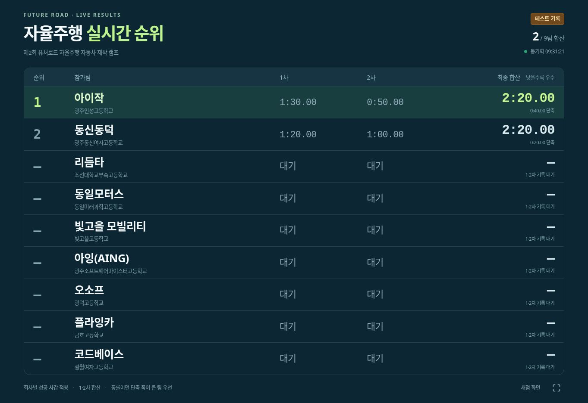

# GitHub에서 수정·관리하기

## 저장 위치

- 저장소: `brulee07-art/FutureRoad_Web`
- 채점 프로그램 브랜치: `track-scoring`
- 프로그램 폴더: `track-scoring/`
- 실행 주소: https://futureroad-track-scoring-2026.brulee07.chatgpt.site

기존 퓨처로드 홈페이지와 함께 관리할 수 있도록 채점 프로그램을 전용 브랜치와 폴더에 보관합니다. 이 브랜치의 `track-scoring/` 안에서 수정하고 커밋하세요.

## GitHub Desktop 사용 순서

1. `File > Clone repository`에서 `brulee07-art/FutureRoad_Web`을 선택합니다. 이미 복제했다면 `Fetch origin`을 누릅니다.
2. `Current branch`에서 `track-scoring`을 선택합니다.
3. `Repository > Show in Explorer`에서 폴더를 열고, 안쪽의 `track-scoring` 폴더를 엽니다.
4. 수정한 후 변경 내역을 확인하고, 설명을 적어 `Commit to track-scoring`을 누릅니다.
5. `Push origin`을 눌러 GitHub에 저장합니다. 다른 PC에서는 먼저 `Fetch origin`과 `Pull origin`으로 최신 내용을 받습니다.

## 주로 수정하는 파일

| 파일 | 내용 |
| --- | --- |
| `lib/scoring.ts` | 팀명·학교명·성공 항목·차감시간·합산 및 동점 기준 |
| `app/score-app.tsx` | 태블릿 채점 화면·전체 순위·전광판 |
| `app/globals.css` | 화면 색상·글자·배치 |
| `public/track-scoring.pdf` | 트랙과 평가 기준 안내 |
| `tests/scoring.test.mjs` | 합산·동점·미완주·CSV 계산 검증 |
| `README.md` | 운영 방법과 평가 기준 |

Node.js 22.13 이상이 있는 환경에서 프로그램 폴더를 기준으로 실행합니다.

```sh
npm ci
node --test tests/scoring.test.mjs tests/server.test.mjs
npx tsc --noEmit
npm run dev
```

## 공유와 실행의 차이

GitHub 주소로 프로그램의 소스와 변경 이력을 공유할 수 있습니다. 이 저장소는 공개 저장소입니다. 실제 채점은 위의 실행 주소에서 사용합니다.

이 프로그램은 서버와 Cloudflare D1 데이터베이스를 사용합니다. GitHub Pages만으로 서버 저장과 실시간 동기화를 실행할 수 없습니다. GitHub에 커밋한 내용은 현재 실행 중인 사이트에 자동 배포되지 않습니다. 수정한 버전을 검증한 뒤 기존 사이트에 별도 배포해야 합니다.

GitHub에는 소스와 안내 파일이 들어가며, 실제 주행 기록은 서비스의 데이터베이스에 저장됩니다. 현재 결과를 별도로 보관하려면 프로그램의 `CSV 내려받기`를 이용합니다.

`.openai/hosting.json`의 Site ID와 D1 설정은 기존 서비스를 갱신할 때 유지합니다. 다른 사람이 독립 서비스를 만들 때는 자신의 사이트와 데이터베이스를 구성해야 합니다. `.env`, `.dev.vars`, `.wrangler`, `.sites-runtime` 및 접속 키는 커밋 대상이 아닙니다.

## 합산 동점 처리 확인

아래는 개발 환경의 테스트 기록입니다. 실제 대회 결과가 아닙니다. 합산이 같은 2분 20초일 때, 40초 단축한 팀이 20초 단축한 팀보다 높은 순위로 표시됩니다.


